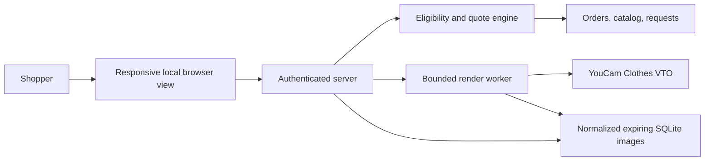

# Implemented local architecture

The browser view, API, policy, SQLite state, and single-process YouCam worker are IMPLEMENTED. Merchant commerce inputs are SIMULATED; production service concerns are NOT IMPLEMENTED.

Actual stack: browser HTML/CSS/JavaScript; TypeScript/Node 24; Fastify; Node SQLite; sharp. A single loopback server serves the view and API. Assets and job state are held locally in SQLite. No blockchain component.

Flow: authorize order → record reason → filter candidates → request consent → upload images → create/poll render task → show reference and preview → revalidate quote/stock → persist approved request.

States: order → optional quote → QUEUED/SUBMITTING/POLLING → SUCCEEDED/FAILED/EXPIRED/DELETED; a separate exchange/refund request ends in REQUESTED. A preview is optional for refund and not itself approval. Inventory changes invalidate the quote and require a fresh one.

Browser and catalog text are untrusted. Server controls policy and prices. YouCam is an external data processor; its result URL expires locally and provider retention is not controlled here. API outages permit the ordinary refund path. The local demo uses seeded orders, one merchant-like catalog, and upper-body products. Multi-process worker leases, managed storage, public identity, payment, inventory reservation, and fulfillment are NOT IMPLEMENTED. No throughput has been measured.
